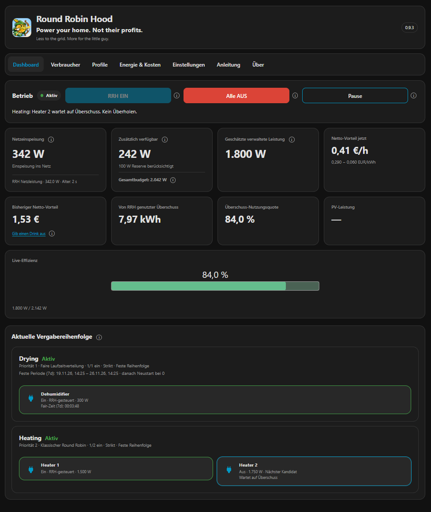
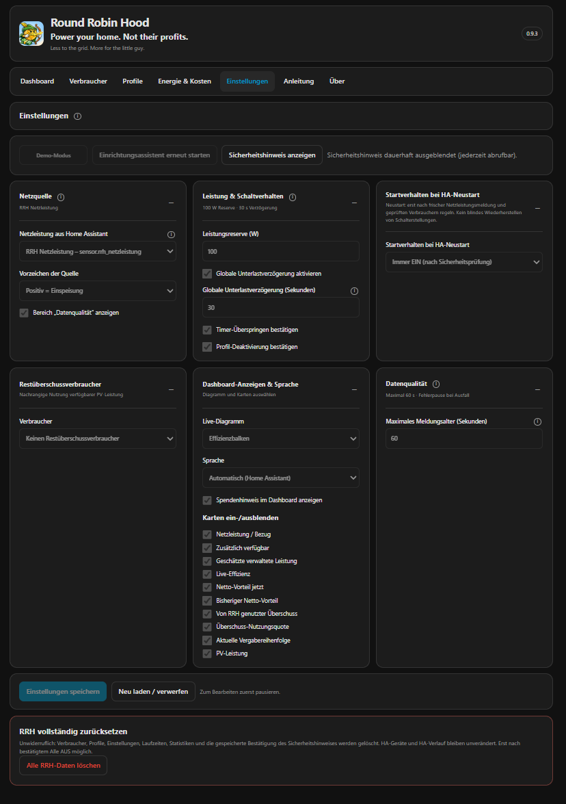
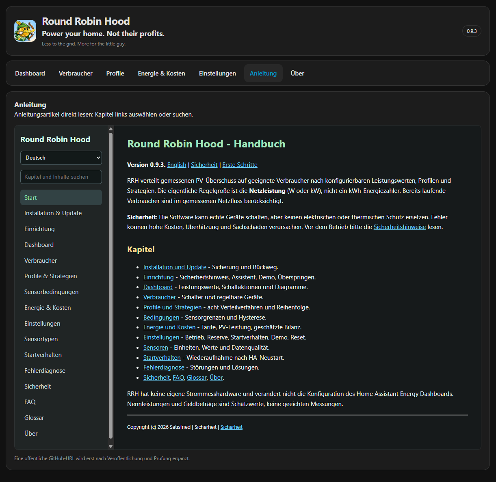

# Round Robin Hood

**Power your home. Not their profits.**  
*Less to the grid. More for the little guy.*

**Round Robin Hood (RRH)** is a Home Assistant custom integration by **Satisfried**. Instead of sending every available watt of solar surplus to the grid, RRH allocates measured grid-export surplus to suitable loads in your home—subject to your priorities, device limits and safety settings.

> **Version 0.9.4:** Open-source Home Assistant integration under [Apache License 2.0](LICENSE). Check [GitHub Releases](https://github.com/satisfried-yt/round-robin-hood/releases) for downloadable versions. Approval for the official Marketplace/HACS catalog is separate and not implied by a GitHub release.

## Watch the introduction

[Watch the Round Robin Hood introduction on YouTube](https://www.youtube.com/watch?v=UV0elAdSXdY) (German)

## At a glance

| Control | Your options |
| --- | --- |
| Solar input | Home Assistant grid-power sensor (W or kW), with selectable export sign |
| Loads | On/off switches, multi-stage appliances, adjustable power targets and an optional residual-surplus consumer |
| Scheduling | Eight allocation strategies, including round robin, fairness, priority and efficiency |
| Safeguards | Reserve, hysteresis, minimum run time, cooldown, delayed deficit handling, sensor freshness and conditions |
| Operation | Responsive sidebar panel, profiles, restart policy, setup wizard and isolated demonstration |
| Insights | Estimates for energy use, utilized surplus and costs based on configured device power and tariffs |

### Eight scheduling strategies

Classic round robin · Fair runtime · Fair energy · Fixed priority · Maximum efficiency · Ascending power · Descending power · Stable operation.

RRH reads the **instantaneous grid power**, not a cumulative energy meter. The measured grid flow already includes consumption by devices that are running. RRH does not independently measure electrical power or guarantee that available PV surplus will cover each appliance.

## Screenshots

Real Round Robin Hood 0.9.3 screens from a Home Assistant test setup. Live values are snapshots; energy and cost figures are **estimates**, not guaranteed savings.

### Dashboard

### More views

| Consumers | Profiles |
| --- | --- |
|  |  |

| Energy and costs | Settings |
| --- | --- |
|  |  |

| In-app handbook | About |
| --- | --- |
|  |  |
<!-- ha-marketplace:exclude-start -->
## Install via Home Assistant Marketplace / HACS

**Search for “Round Robin Hood”** in **Settings → Marketplace** (Home Assistant 2026.11+) or in **HACS** on earlier supported versions.

If the integration is not listed yet, select **Add from link** in Marketplace or add it as a **custom integration repository** in HACS, using `https://github.com/satisfried-yt/round-robin-hood`. The official catalog entry depends on HACS review; a GitHub release or custom URL alone does not mean it has been approved.

<!-- ha-marketplace:exclude-end -->

## Install manually

> **Before starting:** Make a restorable full Home Assistant backup **including `.storage`**. Use a supported Home Assistant installation and make sure that independently protected loads and suitable Home Assistant entities are already available.

1. Obtain a release package from the **official project** when a release has been published. Do not use the entire repository as the Home Assistant integration directory.
2. Copy **only** `custom_components/round_robin_hood` to `/config/custom_components/round_robin_hood` on your Home Assistant installation.
3. Restart Home Assistant Core.
4. Add **Round Robin Hood** under **Settings → Devices & services** and open the RRH sidebar panel.
5. Follow the setup wizard, try the isolated demo or configure manually. Verify the grid sensor's sign and unit before enabling control of real devices.

**Already using RRH?** Back up first, then use the version-specific [upgrade and rollback instructions](docs/UPDATE_0.9.4.md). Those instructions cover **0.9.3 → 0.9.4 only**. Avoid mixing older integration code with newer RRH `.storage` data.

**Marketplace/HACS:** A public, validated repository can be added by URL. Official catalog inclusion is a separate review and is **not** implied by publishing this repository.

## Documentation — six languages

The integration includes an **offline, searchable 16-article handbook** in German, English, French, Spanish, Portuguese and Italian. The same handbook is available as Markdown source for a future documentation website. The German and English guides currently provide more technical detail.

| Language | Start | Safety |
| --- | --- | --- |
| Deutsch | [Handbuch](docs/site/de/index.md) | [Sicherheit](docs/site/de/safety.md) |
| English | [User guide](docs/site/en/index.md) | [Safety](docs/site/en/safety.md) |
| Français | [Guide](docs/site/fr/index.md) | [Sécurité](docs/site/fr/safety.md) |
| Español | [Guía](docs/site/es/index.md) | [Seguridad](docs/site/es/safety.md) |
| Português | [Guia](docs/site/pt/index.md) | [Segurança](docs/site/pt/safety.md) |
| Italiano | [Guida](docs/site/it/index.md) | [Sicurezza](docs/site/it/safety.md) |

For a local documentation website build, see [MkDocs instructions](docs/SITE_BUILD.md). The documentation website has **not** been publicly deployed.

## Safety first

**RRH is not a certified safety controller, electrical protection device, emergency disconnect or calibrated energy meter.** It communicates with devices through Home Assistant; software, sensors and connectivity may fail. A device might remain energized even after RRH attempts to switch it off.

Use appropriate independent thermal protection, wiring and circuit protection, safe physical installation and a real disconnect for heaters and other potentially hazardous loads. **All OFF is not a physical emergency stop.** Costs, energy and savings displayed by RRH are estimates—not certified measurements or guaranteed financial results.

Read the [full safety guidance](docs/site/en/safety.md) before use.

## Version, permissions and project status

- **Version:** 0.9.4. [Releases](https://github.com/satisfried-yt/round-robin-hood/releases) · [Changelog](CHANGELOG.md) · [Release notes](docs/RELEASE_NOTES_0.9.4.md)
- **Software license:** [Apache License 2.0](LICENSE) · [NOTICE](NOTICE). Use, modification and redistribution are allowed under its conditions. [Branding guidance](BRANDING.md) explains attribution and avoiding false endorsement; Apache-2.0 grants no trademark rights.
- **Other software:** [Third-party notices](THIRD_PARTY_NOTICES.md).
- **Publisher information:** [Impressum / Legal notice](http://satisfried.de/). Listing in the official Marketplace catalog remains a separate process.
- **Package verification:** [SHA-256 checksum instructions](VERIFY_RELEASE.md) for the public release ZIP; no detached signature is claimed for 0.9.4.

Development used AI assistance. Third-party materials retain their respective rights; see [notices](THIRD_PARTY_NOTICES.md).

## Satisfried

[YouTube](https://www.youtube.com/@Satisfried_yt) · [TikTok](https://www.tiktok.com/@satisfried_yt) · [Twitch](https://www.twitch.tv/satisfried_yt) · [GitHub](https://github.com/satisfried-yt)

**Impressum / Legal notice:** [satisfried.de](http://satisfried.de/)

Copyright © 2026 Satisfried (project pseudonym), to the extent the publisher holds rights. See [LICENSE](LICENSE) for copyright permissions; no trademark rights are granted by Apache-2.0.
